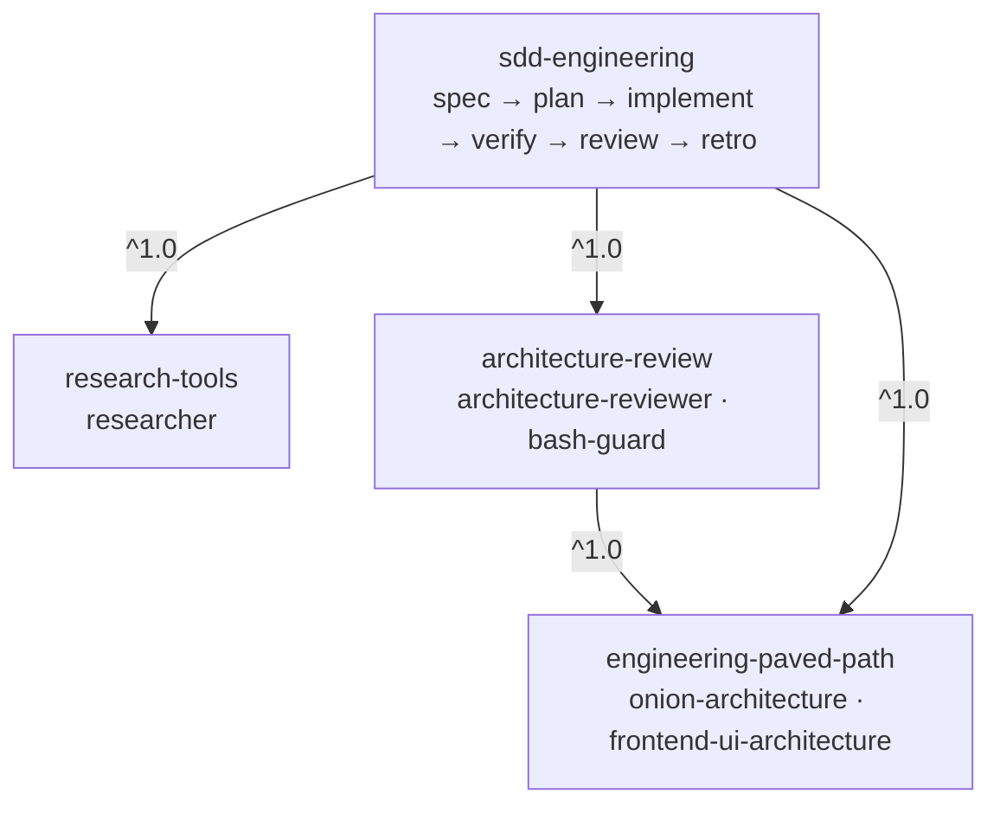

# devdigest-marketplace

Public [Claude Code plugin marketplace](https://code.claude.com/docs/en/plugin-marketplaces) **`lindigo-devdigest`** (course lesson L08). It packages the DevDigest workflows built in lessons L01–L07 as installable plugins.

| Plugin | What it gives you | Depends on |
| :- | :- | :- |
| [`engineering-paved-path`](plugins/engineering-paved-path) | Architecture rules shared by the other plugins: onion backend architecture, frontend UI structure | — |
| [`research-tools`](plugins/research-tools) | Read-only `researcher` agent with evidence for every finding | — |
| [`architecture-review`](plugins/architecture-review) | Read-only `architecture-reviewer` agent with a read-only Bash guard | engineering-paved-path |
| [`sdd-engineering`](plugins/sdd-engineering) | Spec → plan → implement → verify → architecture review → retro | engineering-paved-path, research-tools, architecture-review |

> Status: **1.1.0.** All four plugins ship their stable components and an eval suite (`plugins/<name>/evals/`). Not yet included: the `security`, React, Next.js and testing skills (licence of the originals not confirmed), `brainstorm`, `security-reviewer`, `pr-self-review`, `test-writer`, `doc-writer`. Each plugin README lists them under *Later*.

## Install

Inside a Claude Code session:

```
/plugin marketplace add lindigo-design/devdigest-marketplace
/plugin install sdd-engineering@lindigo-devdigest
```

Installing a plugin installs its dependencies, so `sdd-engineering` pulls in the other three. Install ids always end in `@lindigo-devdigest` (the marketplace `name`), not the repository name.

From a shell:

```bash
claude plugin marketplace add lindigo-design/devdigest-marketplace
claude plugin install sdd-engineering@lindigo-devdigest
claude plugin list
```

**For a whole repository** — register the marketplace once and commit the settings file it writes, so every teammate who trusts the folder gets it:

```bash
claude plugin marketplace add lindigo-design/devdigest-marketplace --scope project
git add .claude/settings.json
```

The repository is public, so no git credentials are needed to add the marketplace.

**Security.** Plugins run with your permissions and hooks execute shell commands. Read a plugin's *Permissions* section before installing. To report a vulnerability, see [docs/SECURITY.md](docs/SECURITY.md).

**Auto-update** is off by default: `/plugin` → *Marketplaces* → `lindigo-devdigest` → *Enable auto-update*, or update manually with `/plugin marketplace update lindigo-devdigest`.

## Catalog site

**<https://lindigo-design.github.io/devdigest-marketplace/>** lets you find any plugin, skill, agent, command, hook or MCP server by describing what you need, in English or Ukrainian (for example "I need a skill for security review"), and copy the install command. Each plugin and component has its own page: what it does, what it may run, its dependencies, compatibility and source. A plugin page also shows how to install it for you, for a whole repository or locally (in a session or a terminal, with the `.claude/settings.json` to commit), how to call each component, how to update, pin or remove it, and a download of the released source.

- Built from this repository only, on every push to `main` ([`site-build.yml`](.github/workflows/site-build.yml)); no manual edits, no backend, no trackers.
- Feeds of plugin releases: [Atom](https://lindigo-design.github.io/devdigest-marketplace/feed.xml) and [JSON Feed](https://lindigo-design.github.io/devdigest-marketplace/feed.json).
- The whole catalog as data: [`index.json`](https://lindigo-design.github.io/devdigest-marketplace/index.json), schema in [docs/catalog-index.md](docs/catalog-index.md).
- Source in [`site/`](site/README.md); specs [CAT-01](docs/specs/marketplace-catalog.md) (catalog) and [CAT-02](docs/specs/install-and-use.md) (install and use).

## Dependency graph



`sdd-engineering` depends on `architecture-review` because `run-plan` runs `architecture-reviewer` on the full diff when every task has passed, and on `research-tools` because `researcher` feeds `spec-creator`.

## Repository layout

```
.claude-plugin/marketplace.json      catalog: name, owner, 4 entries (no versions here)
plugins/<name>/
  .claude-plugin/plugin.json         name, version, dependencies — the only place a version lives
  skills/ agents/ hooks/ evals/      components (only what the plugin uses)
  README.md CHANGELOG.md COMPATIBILITY.md
scripts/                             build-index.mjs (catalog index), release.mjs, tag-release.mjs, rollback.mjs (+ lib/)
site/                                catalog site: Astro + MiniSearch, built from the files above (see site/README.md)
.github/workflows/validate.yml       validate --strict, unit tests, version bump check, smoke install
.github/workflows/site-build.yml     catalog index + site: build and test on PRs, deploy to GitHub Pages from main
.github/scripts/                     CI checks: check-versions.mjs, assert-enabled.mjs
docs/PLUGIN-GUIDELINES.md            what a plugin contains: layout, component rules, helper files, evals, licences
docs/RELEASES.md                     versioning, the full release cycle, tags, update, rollback
docs/SITE-SPEC.md                    catalog site: what it does, where its specs, design and code live
docs/SECURITY.md                     security policy and vulnerability reporting
docs/specs/                          feature specs (catalog site)
docs/plans/                          implementation plans
docs/design/                         catalog site design: concept brief, tokens, Claude Design prompt
docs/catalog-index.md                public schema of the site's index.json
```

Rules for every plugin (full list: [docs/PLUGIN-GUIDELINES.md](docs/PLUGIN-GUIDELINES.md)):

- Paths only via `${CLAUDE_PLUGIN_ROOT}` (bundled files) and `${CLAUDE_PLUGIN_DATA}` (state that survives updates). No `..`, no absolute paths.
- No secrets, caches, eval results or memory files in the repo. User-specific values go in `userConfig` (`sensitive: true` for tokens).
- No top-level `bin/` in a plugin; put executables in `scripts/`.
- Instructions ship as skills — a plugin's `CLAUDE.md` is never loaded.
- Plugin agents ignore `hooks`, `mcpServers` and `permissionMode` frontmatter; hooks go in the plugin's `hooks/hooks.json`.

## Versioning and releases

- `version` lives only in `plugins/<name>/.claude-plugin/plugin.json`; any change under a plugin bumps it (CI checks).
- Release with `node scripts/release.mjs <plugin> patch|minor|major` on a branch, then `node scripts/tag-release.mjs --push` on `main` after merge. Tags are `<plugin>--v<version>`.
- Roll back by rolling forward: `node scripts/rollback.mjs <plugin> <good-version>`; never move a tag or lower a version.

The full cycle, update and rollback details: [docs/RELEASES.md](docs/RELEASES.md).

## Local development

```bash
claude plugin validate --strict .
claude plugin validate --strict plugins/<name>
claude plugin marketplace add ./
claude plugin install <name>@lindigo-devdigest
claude plugin list
```

A marketplace added from a local path loads plugins in place, so edits apply on `/reload-plugins` without a version bump. Remove with `claude plugin marketplace remove lindigo-devdigest`.

To see how a change looks in the catalog site (Node.js ≥ 22.23.4):

```bash
npm --prefix site ci
npm --prefix site run check          # build the catalog only: counts, warnings, or the broken files
npm --prefix site run dev            # live site at http://localhost:4321/devdigest-marketplace/
```

## Provenance and license

Components are derived from DevDigest (MIT, © 2026 Ivan Lapa), local branch `local/all-lessons` @ `a9d6713`. See [LICENSE](LICENSE).
