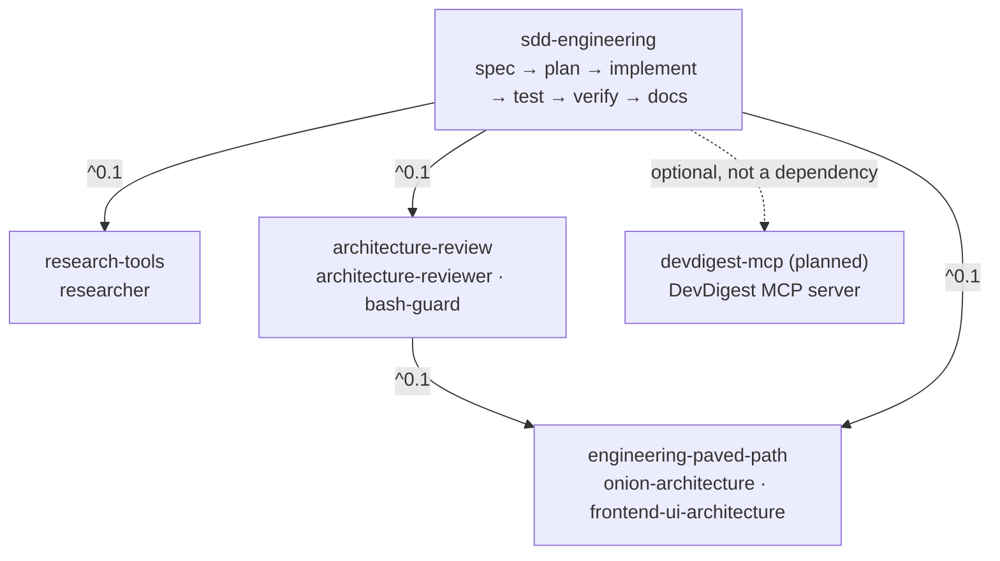

# devdigest-marketplace

Public [Claude Code plugin marketplace](https://code.claude.com/docs/en/plugin-marketplaces) **`lindigo-devdigest`** (course lesson L08). It packages the DevDigest workflows built in lessons L01–L07 as installable plugins.

| Plugin | What it gives you | Depends on |
| :- | :- | :- |
| [`engineering-paved-path`](plugins/engineering-paved-path) | Architecture rules shared by the other plugins: onion backend architecture, frontend UI structure | — |
| [`research-tools`](plugins/research-tools) | Read-only `researcher` agent with evidence for every finding | — |
| [`architecture-review`](plugins/architecture-review) | Read-only `architecture-reviewer` agent with a read-only Bash guard | engineering-paved-path |
| [`sdd-engineering`](plugins/sdd-engineering) | Spec → plan → implement → test → verify → docs | engineering-paved-path, research-tools, architecture-review |

> Status: **0.1.0 scaffold.** Manifests and dependency graph are in place; skills, agents and hooks are migrated one plugin at a time.

## Install

Inside a Claude Code session:

```
/plugin marketplace add lindigo-design/devdigest-marketplace
/plugin install sdd-engineering@lindigo-devdigest
```

Installing a plugin installs its dependencies, so `sdd-engineering` pulls in the other three. Install ids always end in `@lindigo-devdigest` (the marketplace `name`), not the repository name.

From a shell:

```bash
claude plugin marketplace add lindigo-design/devdigest-marketplace
claude plugin install sdd-engineering@lindigo-devdigest
claude plugin list
```

**For a whole repository** — register the marketplace once and commit the settings file it writes, so every teammate who trusts the folder gets it:

```bash
claude plugin marketplace add lindigo-design/devdigest-marketplace --scope project
git add .claude/settings.json
```

The repository is public, so no git credentials are needed to add the marketplace.

**Security.** Plugins run with your permissions and hooks execute shell commands. Read a plugin's *Permissions* section before installing. To report a vulnerability, see [docs/SECURITY.md](docs/SECURITY.md).

**Auto-update** is off by default: `/plugin` → *Marketplaces* → `lindigo-devdigest` → *Enable auto-update*, or update manually with `/plugin marketplace update lindigo-devdigest`.

## Catalog site

**<https://lindigo-design.github.io/devdigest-marketplace/>** lets you find any plugin, skill, agent, command, hook or MCP server by describing what you need, in English or Ukrainian (for example "I need a skill for security review"), and copy the install command. Each plugin and component has its own page: what it does, what it may run, its dependencies, compatibility and source.

- Built from this repository only, on every push to `main` ([`pages.yml`](.github/workflows/pages.yml)); no manual edits, no backend, no trackers.
- Feeds of plugin releases: [Atom](https://lindigo-design.github.io/devdigest-marketplace/feed.xml) and [JSON Feed](https://lindigo-design.github.io/devdigest-marketplace/feed.json).
- The whole catalog as data: [`index.json`](https://lindigo-design.github.io/devdigest-marketplace/index.json), schema in [docs/catalog-index.md](docs/catalog-index.md).
- Source in [`site/`](site/README.md); spec [CAT-01](docs/specs/marketplace-catalog.md).

## Dependency graph



`sdd-engineering` depends on `architecture-review` because `implement-plan` runs `architecture-reviewer` and `security-reviewer` on *Finish*.

**DevDigest MCP** is not a dependency. `spec-creator` can use the DevDigest MCP tools when they are available; they will ship later as a separate `devdigest-mcp` plugin.

## Repository layout

```
.claude-plugin/marketplace.json      catalog: name, owner, 4 entries (no versions here)
plugins/<name>/
  .claude-plugin/plugin.json         name, version, dependencies — the only place a version lives
  skills/ agents/ hooks/ evals/      components (only what the plugin uses)
  README.md CHANGELOG.md COMPATIBILITY.md
scripts/                             release.mjs, tag-release.mjs, rollback.mjs (+ lib/ with unit tests)
site/                                catalog site: Astro + MiniSearch, built from the files above (see site/README.md)
.github/workflows/validate.yml       validate --strict, unit tests, version bump check, smoke install
.github/workflows/pages.yml          catalog site: build and test on PRs, deploy to GitHub Pages from main
.github/scripts/                     CI checks: check-versions.mjs, assert-enabled.mjs
docs/SECURITY.md                     security policy and vulnerability reporting
docs/specs/                          feature specs (catalog site)
docs/plans/                          implementation plans
docs/design/                         catalog site design: concept brief, tokens, Claude Design prompt
docs/catalog-index.md                public schema of the site's index.json
docs/temp/                           temporary working notes, deleted once plugins are migrated
```

Rules for every plugin:

- Paths only via `${CLAUDE_PLUGIN_ROOT}` (bundled files) and `${CLAUDE_PLUGIN_DATA}` (state that survives updates). No `..`, no absolute paths.
- No secrets, caches, eval results or memory files in the repo. User-specific values go in `userConfig` (`sensitive: true` for tokens).
- No top-level `bin/` in a plugin; put executables in `scripts/`.
- Instructions ship as skills — a plugin's `CLAUDE.md` is never loaded.
- Plugin agents ignore `hooks`, `mcpServers` and `permissionMode` frontmatter; hooks go in the plugin's `hooks/hooks.json`.

## Versioning and releases

- `version` lives **only** in `plugins/<name>/.claude-plugin/plugin.json`, never in `marketplace.json`. Users get a new copy only when this string changes.
- Any change under `plugins/<name>/` must bump that plugin's version (SemVer). CI fails a PR that changes a plugin without raising its version above `main`.
- Dependencies use caret ranges on `0.x` minors (`^0.1` = `>=0.1.0 <0.2.0`). A breaking change in a base plugin bumps its minor and requires dependents to widen their range in the same PR.
- Update the plugin's `CHANGELOG.md` in the same PR.

| Step | Command | Where |
| :- | :- | :- |
| Prepare a release | `node scripts/release.mjs <plugin> patch\|minor\|major` | feature branch |
| Release several plugins together | `node scripts/release.mjs <plugin>=major <plugin>=major …` | feature branch |
| Tag released versions | `node scripts/tag-release.mjs --push` | `main`, after merge |
| Roll back | `node scripts/rollback.mjs <plugin> <good-version> --reason "<why>"` | feature branch, then tag after merge |

Every script supports `--dry-run` and `--help`. They need only Node ≥ 22 and git; validation uses the `claude` CLI when it is on `PATH`.

### Release

Write release notes under `## [Unreleased]` in the plugin's `CHANGELOG.md`, then on a branch:

```bash
node scripts/release.mjs <plugin> patch|minor|major [--update-dependents] [--dry-run]
```

The script bumps `version` in `plugin.json`, moves the `[Unreleased]` notes into a dated version section and runs `claude plugin validate --strict`. If the new version breaks a dependent's range (for example `engineering-paved-path` `0.2.0` vs `^0.1`), it stops; `--update-dependents` widens those ranges and patch-releases the dependents in the same change.

### Release tags

After the PR is merged, tag every plugin whose version has no tag yet (`<plugin>--v<version>`), on `main`:

```bash
node scripts/tag-release.mjs --dry-run
node scripts/tag-release.mjs --push
```

It wraps `claude plugin tag`, which also checks that `plugin.json` and the marketplace entry agree. Dependency ranges resolve against these tags, so a missing tag means dependents get whatever is on the default branch.

### Update

```
/plugin marketplace update lindigo-devdigest
/reload-plugins
```

or from a shell: `claude plugin update <plugin>@lindigo-devdigest` (restart required).

### Rollback = roll forward + bump

Never move or delete a published tag and never lower a version: clients compare versions and would keep the cached copy.

```bash
node scripts/rollback.mjs <plugin> <good-version> --reason "<why>" [--dry-run]
```

The script restores `plugins/<plugin>/` from the tag `<plugin>--v<good-version>`, sets the version to the next patch **above** the bad one (bad `0.2.1` → `0.2.2` with the content of `0.2.0`), keeps the CHANGELOG history and adds a `### Reverted` entry naming the withdrawn versions. It refuses when the good version's dependency ranges no longer match the current dependencies. Then open a PR, merge, and run `node scripts/tag-release.mjs --push`.

To undo one commit instead of a whole version, `git revert <sha>` and release a patch with `scripts/release.mjs`.

Users who must stay on a known-good catalog meanwhile can add the marketplace pinned to a ref: `/plugin marketplace add lindigo-design/devdigest-marketplace#<tag-or-branch>`.

**Renaming or removing a plugin:** never change `name` in place. Use `displayName` for a new label; for a real rename or removal add an entry to the append-only `renames` map in `marketplace.json`.

## Local development

```bash
claude plugin validate --strict .
claude plugin validate --strict plugins/<name>
claude plugin marketplace add ./
claude plugin install <name>@lindigo-devdigest
claude plugin list
```

A marketplace added from a local path loads plugins in place, so edits apply on `/reload-plugins` without a version bump. Remove with `claude plugin marketplace remove lindigo-devdigest`.

To see how a change looks in the catalog site (Node.js ≥ 22.23.4):

```bash
npm --prefix site ci
npm --prefix site run check          # build the catalog only: counts, warnings, or the broken files
npm --prefix site run dev            # live site at http://localhost:4321/devdigest-marketplace/
```

## Provenance and license

Components are derived from DevDigest (MIT, © 2026 Ivan Lapa), local branch `local/all-lessons` @ `a9d6713`. See [LICENSE](LICENSE).
