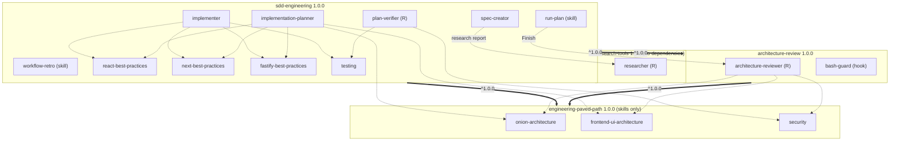

# SDD plugin set: components, reuse and releases

| | |
| :- | :- |
| Spec ID | `SDD-01` |
| Status | approved 2026-11-09 (rev. 5: + R1/AC-9, R4/AC-3, R5/AC-9, AC-10, AC-11, R5/AC-4 range form, R6/AC-6, AC-7) |
| Owner | @lindigo-design |
| Created | 2026-11-09 |
| Scope | `plugins/engineering-paved-path`, `plugins/research-tools`, `plugins/architecture-review`, `plugins/sdd-engineering` |

This spec covers WHAT goes into each plugin and WHY. The HOW (file-by-file migration, hook code, eval cases) belongs in a plan, written once this spec is approved.

## 1. Why

The four plugins are 0.1.0 scaffolds with no components. The team wants one installable spec-driven development (SDD) workflow: write a spec, plan it, implement it, verify it, then learn from the run. The workflow must stay small. Its general-purpose parts (research, architecture review, architecture and security rules) must be usable on their own, and installing one of them must not load skills it never uses: every installed skill's description is added to the context of every session.

## 2. Goals and non-goals

**Goals**

1. `sdd-engineering` ships the SDD workflow: 4 agents (`spec-creator`, `implementation-planner`, `implementer`, `plan-verifier`), the workflow skills `run-plan` and `workflow-retro`, and the stack skills only its agents use.
2. Reusable parts live in separate plugins, each usable alone:
   - `engineering-paved-path`: architecture and security skills shared by `sdd-engineering` and `architecture-review`;
   - `research-tools`: the read-only `researcher` agent, with **no dependencies**;
   - `architecture-review`: a generalized `architecture-reviewer` agent.
3. `sdd-engineering` depends on all three plugins with range `^1.0.0`.
4. Every plugin has a README that explains its workflow, and a CHANGELOG with every release. The `sdd-engineering` README explains how all four plugins work together.

**Non-goals (not migrated)**

- Product specs and plans from DevDigest.
- Secrets, tokens, `.env`, caches, eval results, memory files.
- DevDigest-specific instructions: project paths (`server/src`, `client/src`, …), product names, the DevDigest MCP tools, course-lesson references. The MIT licence notice and the provenance line are not "DevDigest traces": MIT requires the notice, so they stay.
- Any third-party skill whose licence is not confirmed (section 7).
- A plugin that bundles the DevDigest MCP server.

## 3. Component map

**Placement rule:** a skill lives in the lowest plugin that every one of its users depends on. A skill used by agents of one plugin only lives in that plugin. A skill used by agents of several plugins lives in a plugin all of them depend on.

`R` = read-only agent (no `Write`, `Edit`, `NotebookEdit`). Skill references across plugins use `<plugin>:<skill>`.

### 3.0 Dependency graph

Solid arrows are plugin `dependencies` in `plugin.json` (installed automatically). Dotted arrows show which component uses which skill or agent.

**Who uses what**

| Skill | Plugin | Used by |
| :- | :- | :- |
| `onion-architecture` | engineering-paved-path | architecture-reviewer, implementation-planner |
| `frontend-ui-architecture` | engineering-paved-path | architecture-reviewer, implementation-planner |
| `security` | engineering-paved-path | architecture-reviewer, plan-verifier |
| `react-best-practices` | sdd-engineering | implementer, implementation-planner |
| `next-best-practices` | sdd-engineering | implementer, implementation-planner |
| `fastify-best-practices` | sdd-engineering | implementer, implementation-planner |
| `testing` | sdd-engineering | implementer, plan-verifier |
| — | research-tools | `researcher` uses no skill |

### 3.1 `engineering-paved-path` (base, skills only)

| Kind | Name | Purpose |
| :- | :- | :- |
| skill | `onion-architecture` | Backend layering rules: rings, dependency direction, where a module's code goes |
| skill | `frontend-ui-architecture` | Frontend UI structure rules: routes, components, hooks, state, client boundary |
| skill | `security` | Security rubric and checklists. **Blocked by licence** (section 7.1) |

No agents, hooks or executables. All three skills are **generalized**: the DevDigest sources hard-code `server/src/modules/<name>/`, `client/`, `platform/container.ts` and DevDigest product terms (15 and 12 such mentions in the two architecture `SKILL.md` files). The migrated skills describe the rules in terms of roles (backend source root, module, UI source root) and take the actual paths from the consuming repository, discovered or asked for (R1/AC-5). Examples and evals keep working by using a neutral sample layout.

### 3.2 `research-tools` (no dependencies)

| Kind | Name | Purpose |
| :- | :- | :- |
| agent (R) | `researcher` | Answers one concrete question from the codebase or external docs; returns a report with evidence (file:line or URL) and an explicit *not found* list. Tools: `Read`, `Grep`, `Glob`, `Bash` (read-only), `WebSearch`, `WebFetch`. |

### 3.3 `architecture-review`

| Kind | Name | Purpose |
| :- | :- | :- |
| agent (R) | `architecture-reviewer` | Reviews a diff or a set of files against the architecture skills; returns findings with severity (`blocking`, `major`, `minor`), location and fix. Preloads `engineering-paved-path:onion-architecture`, `engineering-paved-path:frontend-ui-architecture`, `engineering-paved-path:security`. Generalized: rules come only from those skills and from the consuming repository. |
| hook | `bash-guard` | `PreToolUse` on `Bash`: read-only command allowlist for read-only agents (see section 5.1). |

### 3.4 `sdd-engineering`

| Kind | Name | Writes to | Purpose |
| :- | :- | :- | :- |
| agent | `spec-creator` | `specs/` only | Turns a request (plus research reports) into a spec: why, goals, non-goals, EARS acceptance criteria, open questions. |
| agent | `implementation-planner` | `plans/` only | Turns an approved spec into a plan: tasks with files, steps, verify commands, and a map from each acceptance criterion to tasks. |
| agent | `implementer` | project code and tests | Implements one plan task, runs its verify commands, reports what changed. |
| agent (R) | `plan-verifier` | — | Checks finished work against the plan and the spec's acceptance criteria; returns pass/fail per criterion with evidence. |
| skill | `run-plan` | — | Runs an approved plan in the main session (section 4). |
| skill | `workflow-retro` | `retros/` (after user OK) | Analyses a finished run: what went to plan, deviations, rework, lessons; proposes changes to skills, agents or the plan template. |
| skill | `react-best-practices` | — | React components, state, effects, performance. **Blocked by licence** |
| skill | `next-best-practices` | — | Next.js App Router, data fetching, rendering modes. **Upstream not shippable**: our own short skill or a listed prerequisite |
| skill | `fastify-best-practices` | — | Fastify routes, plugins, validation, errors. Third-party, MIT, ships with attribution |
| skill | `testing` | — | Test strategy and React Testing Library patterns. **Blocked by licence** |
| hook | `write-scope` | — | `PreToolUse` on `Write`/`Edit`: `spec-creator` → `specs/` only, `implementation-planner` → `plans/` only. |

Folder names `specs/`, `plans/`, `retros/` are matched as a path segment anywhere in the repository (so `docs/specs/` also passes).

### 3.5 Context cost, before and after this revision

Measured with `claude plugin details` (Claude Code 2.1.318) on trial plugins built from the DevDigest sources as they are today, before generalization: branch `local/all-lessons` @ `b288d63`. Proxies: `implement-plan` for `run-plan`, `react-testing-library` for `testing`, `implementer-backend` for `implementer`. Figures are the tool's estimates of the **always-on** cost (skill and agent descriptions loaded in every session); the on-invoke cost is paid only when a component runs and does not change with placement.

| Plugin | Rev. 1 (7 skills in paved-path) | Rev. 2 (this spec) |
| :- | -: | -: |
| `engineering-paved-path` | ~1,159 tok (7 skills) | ~642 tok (3 skills) |
| `research-tools` | ~205 tok | ~205 tok |
| `architecture-review` | ~240 tok | ~240 tok |
| `sdd-engineering` | ~1,316 tok (2 skills, 4 agents) | ~1,829 tok (6 skills, 4 agents) |

| What a user installs | Rev. 1 | Rev. 2 | Change |
| :- | -: | -: | -: |
| `research-tools` alone | ~1,364 tok (pulls paved-path) | ~205 tok | −85 % |
| `architecture-review` alone | ~1,399 tok | ~882 tok | −37 % |
| `sdd-engineering` (all four) | ~2,920 tok | ~2,916 tok | ≈ 0 |

The full SDD install costs the same; installing a reusable plugin alone no longer pays for stack skills it never uses. Numbers are re-measured on the migrated components in the plan's final task and replace these.

## 4. How the workflow runs

Subagents cannot start other subagents, so all orchestration happens in the **main session**. Agents return reports; the main session (driven by the user or by `run-plan`) decides what runs next.

```mermaid
graph LR
    U["User request"] --> R["researcher<br/>(research-tools)"]
    R --> S["spec-creator"]
    S -->|"user approves spec"| P["implementation-planner"]
    P -->|"user approves plan"| RP["run-plan"]
    RP --> I["implementer<br/>(per task)"]
    I --> V["plan-verifier"]
    V -->|"fail"| I
    V -->|"all tasks pass"| A["architecture-reviewer<br/>(architecture-review)"]
    A --> RT["workflow-retro"]
```

1. **Research (optional).** The user or the main session asks `researcher`; its report goes to `spec-creator` as input.
2. **Spec.** `spec-creator` writes `specs/<id>.md` with status `draft`. The user approves it by changing the status to `approved`.
3. **Plan.** `implementation-planner` reads an approved spec and writes `plans/<id>.md` with status `draft`. The user approves it the same way.
4. **Run.** `/sdd-engineering:run-plan <plan>` refuses a plan that is not `approved`. For each task in order: `implementer` → `plan-verifier`. A failed task goes back to `implementer` once with the verifier's findings; a second failure stops the run and reports to the user.
5. **Finish.** When all tasks pass, `run-plan` sends the full diff to `architecture-reviewer`. Blocking findings stop the run and are reported; the user decides whether to fix or accept them.
6. **Retro.** `run-plan` offers `/sdd-engineering:workflow-retro`. The retro is shown first and saved to `retros/` only with the user's OK.

`run-plan` never commits or pushes.

## 5. Hooks

Plugin hooks are declared in each plugin's `hooks/hooks.json` (plugin agents ignore `hooks` in frontmatter). They fire for the whole session and in every subagent, so each script checks which agent called it.

**How a hook identifies the calling subagent** (Claude Code docs, [Hooks reference → Common input fields](https://code.claude.com/docs/en/hooks#common-input-fields) and [SubagentStart](https://code.claude.com/docs/en/hooks#subagentstart)):

- "Hooks from settings files, managed policy settings, and plugins also run inside subagents. When a subagent calls a tool, tool events such as `PreToolUse` and `PostToolUse` fire the same configured hooks as in the main conversation, and the input carries the `agent_id` and `agent_type` common input fields that identify the subagent."
- `agent_type` is "present when the session uses `--agent` or the hook fires inside a subagent."
- "For subagents shipped by a plugin, the agent type is the plugin-scoped identifier such as `my-plugin:reviewer`, not the bare frontmatter name."

So a script compares `agent_type` with exact strings such as `architecture-review:architecture-reviewer` and `sdd-engineering:plan-verifier`, and allows the call unchanged when `agent_type` is absent (main session) or not listed. The `PreToolUse` matcher filters by tool name only, so the agent check lives in the script.

**Minimum version (decided).** Older releases are not tested. The declared minimum in every plugin's `COMPATIBILITY.md` is raised to **2.1.318**, the version this behaviour is verified on and the version pinned in CI (R5/AC-8). The catalog's compatibility badges follow automatically.

### 5.1 `bash-guard`: one copy or two

The DevDigest `bash-guard.mjs` is one script with profiles (`review`, `verify`, `tests`, `docs`); today each agent passes its profile in its frontmatter hook. Two read-only agents in this spec need it: `architecture-reviewer` (profile `review`) and `plan-verifier` (profile `verify`).

| | A. One copy in `architecture-review` | B. Two identical copies + CI check |
| :- | :- | :- |
| Where | `architecture-review/hooks/`, mapping `architecture-review:architecture-reviewer` → `review` and `sdd-engineering:plan-verifier` → `verify` | Same script in `architecture-review` and `sdd-engineering`; each `hooks.json` maps only its own agents |
| Works with SDD | Yes: `sdd-engineering` always installs `architecture-review` | Yes |
| Coupling | `architecture-review` names an agent of a plugin that depends on it (dependency points the wrong way). Changing `plan-verifier`'s name or Bash needs means releasing `architecture-review` first, then widening the range in `sdd-engineering`. | Each plugin owns the policy for its own agents. A guard change is released in both plugins in the same PR. |
| Cost per `Bash` call | 1 node process | 2 node processes (each exits at once when `agent_type` is not its own) |
| Drift risk | None | A unit test fails when the two files differ |

**Decision: B (accepted in review).** A base plugin must not know the agents of plugins built on top of it; with A, `architecture-review` installed alone would ship a rule for an agent that does not exist, and SDD changes would need cross-plugin releases. The extra cost is one short node start per `Bash` call. If later more plugins need the guard, move the script to `engineering-paved-path` with a profile map supplied by each plugin.

## 6. Requirements (EARS)

### SDD-01/R1: Component placement

- **AC-1:** Each plugin SHALL contain exactly the components listed for it in section 3, and no other agents, skills or hooks.
- **AC-2:** Every agent and skill SHALL have YAML frontmatter with `name` and `description`; every agent SHALL declare `tools` or `disallowedTools`.
- **AC-3:** WHEN an agent or skill references a skill from another plugin, it SHALL use `<plugin>:<skill>` (for example `engineering-paved-path:security`), and that plugin SHALL be in the referencing plugin's `dependencies`.
- **AC-4:** WHEN a skill runs a supporting script, it SHALL locate it through `${CLAUDE_SKILL_DIR}`, never through `.claude/skills/`.
- **AC-5:** WHERE a DevDigest component read or named a fixed DevDigest path, the migrated component SHALL take that path as an explicit input (argument, discovery in the consuming repository, or a question to the user) instead.
- **AC-6:** `sdd-engineering` SHALL ship evals for its agents and skills under `evals/`, migrated with them.
- **AC-7:** A skill SHALL live in a plugin that every plugin using it depends on (or is), and SHALL NOT live in a plugin none of whose dependents use it.
- **AC-8:** `research-tools` SHALL have no `dependencies`.
- **AC-9:** Every cross-plugin reference in component text (agent and skill bodies and frontmatter, hook scripts, evals), in the forms `<plugin>:<skill>` and `<plugin>:<agent>` (for example `run-plan` naming `architecture-review:architecture-reviewer`), SHALL name a plugin that is in the referencing plugin's `dependencies`. CI SHALL fail with `file:line` and the missing dependency otherwise.

### SDD-01/R2: Read-only and write scope

- **AC-1:** `researcher`, `architecture-reviewer` and `plan-verifier` SHALL NOT have `Write`, `Edit` or `NotebookEdit`.
- **AC-2:** WHILE `agent_type` is `architecture-review:architecture-reviewer` or `sdd-engineering:plan-verifier`, `bash-guard` SHALL deny any `Bash` command not on that agent's profile allowlist and SHALL name the reason.
- **AC-3:** WHEN `agent_type` is `sdd-engineering:spec-creator` and the target is outside a `specs/` path segment, or `sdd-engineering:implementation-planner` and the target is outside a `plans/` path segment, `write-scope` SHALL deny the call.
- **AC-4:** WHILE `agent_type` is absent or not listed in a hook, the hook SHALL allow the call unchanged.
- **AC-5:** Each hook SHALL ship a self-test that covers allow and deny cases and runs with `node` only.
- **AC-6:** The `bash-guard` scripts in `architecture-review` and `sdd-engineering` SHALL be byte-identical, checked by a unit test.

### SDD-01/R3: Workflow

- **AC-1:** IF the plan passed to `run-plan` does not have status `approved`, THEN `run-plan` SHALL stop and tell the user why.
- **AC-2:** WHEN a task fails verification twice, `run-plan` SHALL stop and report the task, the findings and the files changed so far.
- **AC-3:** WHEN all tasks pass, `run-plan` SHALL run `architecture-reviewer` on the full diff before reporting the run as done.
- **AC-4:** `run-plan` and every agent SHALL NOT run `git commit` or `git push`.
- **AC-5:** `workflow-retro` SHALL write a file only after the user confirms.

### SDD-01/R4: No DevDigest leakage

- **AC-1:** Component files SHALL NOT contain DevDigest product names, DevDigest paths (`server/src`, `client/src`, `platform/container.ts`, …), `mcp__devdigest__*` tools or course-lesson references. Provenance lines in `CHANGELOG.md` are the only exception.
- **AC-2:** All component text SHALL be in English (repository rule).
- **AC-3:** CI SHALL scan agents, skills (with their references, examples and scripts), hooks, scripts, evals and plugin READMEs against a denylist and fail with `file:line` and the matched term. The denylist contains at least (case-insensitive): `DevDigest`, `dev-digest`, `devdigest-ai`, `server/src`, `client/src`, `platform/container.ts`, `mcp__devdigest__`, `local/all-lessons`, lesson codes `L01`–`L08` (as whole words), `.claude/skills/`, `$CLAUDE_PROJECT_DIR/.claude`. Exempt: the provenance lines in `CHANGELOG.md`, `LICENSE`, `THIRD_PARTY_NOTICES.md` and `sources.json`, and this marketplace's own identifiers (`lindigo-devdigest`, `lindigo-design/devdigest-marketplace`), which appear in every install command.

### SDD-01/R5: Documentation and releases

- **AC-1:** Each plugin README SHALL list its components with purpose, permissions and dependencies, replacing the 0.1.0 "planned" table.
- **AC-2:** The `sdd-engineering` README SHALL describe the full workflow (section 4), including what the user approves at each step and which plugin supplies each agent and skill.
- **AC-3:** Each plugin's `CHANGELOG.md` SHALL have an entry for every released version. The `1.0.0` entries SHALL carry the line `Source: DevDigest (MIT, © 2026 Ivan Lapa), branch local/all-lessons @ b288d63`. The existing `0.1.0` entries (`a9d6713`) SHALL stay unchanged: the changelog is append-only.
- **AC-4:** The first release with components SHALL be `1.0.0` for all four plugins, made with `scripts/release.mjs`. `sdd-engineering` SHALL depend on the three others with `^1.0`; `architecture-review` SHALL depend on `engineering-paved-path` with `^1.0`. `^1.0` is the form `release.mjs` writes and means `>=1.0.0 <2.0.0`, the same range as `^1.0.0` on the slides.
- **AC-5:** WHEN `sdd-engineering` is installed into an empty config, the other three plugins SHALL be installed and enabled automatically (existing CI smoke install).
- **AC-6:** The root README dependency graph and the `marketplace.json` descriptions SHALL match the shipped components.
- **AC-7:** The spec's section 3.5 SHALL be updated with `claude plugin details` figures measured on the migrated plugins.
- **AC-8:** Every plugin's `COMPATIBILITY.md` SHALL declare Claude Code ≥ 2.1.318 as the minimum.
- **AC-9:** Each plugin README SHALL have a **How to use** section with example prompts or invocations (`/<plugin>:<skill> …`, `@agent-<plugin>:<agent> …`) and what the user gets back, plus sections for components, permissions, dependencies, "Later" items and licence notes. Text from DevDigest READMEs (`.claude/agents/README.md`, `.claude/skills/README.md`, per-skill READMEs) MAY be reused only when adapted to pass R4/AC-3, never copied verbatim.
- **AC-10:** Every plugin, skill and agent SHALL have an English description written for two readers, Claude (it decides when a skill is invoked or an agent is delegated to) and people (the catalog card shows the first sentence, `/plugin` the plugin line):
  - *plugin:* one sentence, ≤ 140 characters, what the user gets and its key components, matching what the release ships; identical in `plugin.json` and the `marketplace.json` entry;
  - *skill:* third person; a first sentence that says what it does and stands alone; then "Use when …" with concrete triggers (tasks, file types, phrases a user would type); optionally "Not for … (use `<plugin>:<skill>`)";
  - *agent:* a first sentence that stands alone; when to delegate, what it returns, its limits (read-only, write scope, never commits), and "Not for … (use …)";
  - no "helps with", "various" or marketing words, no Ukrainian trigger phrases, nothing project-specific (R4).
- **AC-11:** CI SHALL fail, naming the file and the reason, WHEN a plugin, skill or agent has no description; a plugin description exceeds 140 characters or differs between `plugin.json` and `marketplace.json`; a skill or agent description exceeds 1024 characters or its first sentence exceeds 200; or a description contains `TODO`, `TBD`, `FIXME` or `XXX`.

### SDD-01/R6: Licensing and third-party sources

- **AC-1:** Every skill SHALL have a recorded source: DevDigest (own work) or a third-party source URL with its SPDX licence identifier.
- **AC-2:** Every third-party skill SHALL ship its licence and attribution, either as a `LICENSE` file in the skill directory or as an entry in a root `THIRD_PARTY_NOTICES.md` naming the skill, source URL, licence and copyright holder.
- **AC-3:** IF a skill's source or licence is unknown or not confirmed, THEN that skill SHALL NOT be added to the repository (the repository is public, so a commit is publication), and the plugin README SHALL list it as a prerequisite or "Later" item.
- **AC-4:** CI SHALL fail, naming the skill, WHEN a skill under `plugins/*/skills/` has no recorded source, or a third-party skill has no licence entry.
- **AC-5:** Migrated DevDigest components SHALL keep the MIT notice (© 2026 Ivan Lapa) through the plugin's `LICENSE` or `THIRD_PARTY_NOTICES.md`, as MIT requires.
- **AC-6:** Every agent's `skills:` list SHALL reference only skills present in the same release: a skill of the agent's own plugin, or `<plugin>:<skill>` of a declared dependency, where that skill exists. CI SHALL fail, naming the agent and the skill, otherwise. An agent never points at a skill that was not shipped.
- **AC-7:** WHEN a blocked skill is resolved after 1.0.0, it SHALL ship as a minor release (for example `1.1.0`) of its plugin, together with the agents' `skills:` lists that start using it.

## 7. Sources

| Plugin | Source repository and commit |
| :- | :- |
| all | DevDigest (MIT, © 2026 Ivan Lapa), branch `local/all-lessons` @ `b288d63` (pinned for 1.0.0; the 0.1.0 entries name `a9d6713` and stay as they are). |

### 7.1 Licence status per skill

| Skill | Origin | Licence | Status |
| :- | :- | :- | :- |
| `onion-architecture` | DevDigest (own) | MIT © 2026 Ivan Lapa | ships |
| `frontend-ui-architecture` | DevDigest (own) | MIT © 2026 Ivan Lapa | ships |
| `run-plan` (from `implement-plan`) | DevDigest (own) | MIT © 2026 Ivan Lapa | ships |
| `workflow-retro` | DevDigest (own) | MIT © 2026 Ivan Lapa | ships |
| `fastify-best-practices` | [mcollina/skills](https://github.com/mcollina/skills) (`skills/fastify`) | MIT | ships with attribution (R6/AC-2) |
| `next-best-practices` | [vercel-labs/next-skills](https://github.com/vercel-labs/next-skills) | no licence file found | **not shipped** until a licence is confirmed; meanwhile our own short skill or a listed prerequisite |
| `react-best-practices` | unknown | unknown | **blocked** until the owner provides source and licence (asked of the course author) |
| `testing` (from `react-testing-library`, which reworks an "original skill") | unknown | unknown | **blocked**, same as above |
| `security` | unknown | unknown | **blocked**, same as above |

Agents (`spec-creator`, `implementation-planner`, `implementer`, `plan-verifier`, `researcher`, `architecture-reviewer`) and hooks are DevDigest's own work, MIT © 2026 Ivan Lapa.

If a blocked skill is still unresolved when the rest is ready, the release goes ahead without it (R6/AC-3), the agents that would use it leave it out of their `skills:` lists (R6/AC-6) and fall back to the consuming repository's own conventions. It ships later as a minor release (R6/AC-7).

## 8. Open questions

| # | Question | Recommendation |
| :- | :- | :- |
| Q1 | The 0.1.0 scaffold plans more components than this spec: `brainstorm` (research-tools); `security-reviewer`, `pr-self-review`, push `gate` (architecture-review); `implementer-backend`/`-frontend`, `test-writer`, `doc-writer`, `implementer-protocol` (sdd-engineering); `guardrails`, `engineering-insights`, `mermaid-diagram` (paved-path). Drop or defer? | Defer to later minor releases; list them under "Later" in each README. Place each by the rule in section 3. One `implementer` replaces the backend/frontend pair. |
| Q2 | `workflow-retro` is planned in `engineering-paved-path`; the slides put it in `sdd-engineering`. | Move it to `sdd-engineering`: only SDD uses it. |
| Q3 | Stack skills from DevDigest not on the slides: `typescript-expert`, `zod`, `drizzle-orm-patterns`, `postgresql-table-design`. | Leave out of 1.0.0; if added later, they go to `sdd-engineering` (only its agents use them). |
| Q4 | ~~Version range form~~ | **Decided:** `^1.0`, the form `release.mjs` writes; same range as `^1.0.0` (R5/AC-4). |
| Q5 | Should `specs/`, `plans/`, `retros/` be configurable per project (`userConfig`)? | Not in 1.0.0; path-segment matching covers `docs/specs/` etc. |
| Q6 | ~~Does the declared minimum send `agent_type` to `PreToolUse` hooks?~~ | **Decided:** no testing of old releases; minimum raised to 2.1.318 (R5/AC-8). |
| Q7 | Source and licence of `react-best-practices`, `testing`, `security`. | Owner is asking the course author; blocked until answered (section 7.1). |
