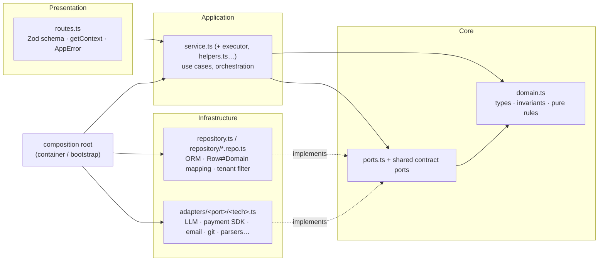

# Onion Architecture for a modular backend

**One rule:** source code dependencies point **inward only**. The core knows nothing about the HTTP
framework, the ORM, the database driver, SDKs, the container or `process.env`. Outer rings implement
interfaces that inner rings define, and the **composition root** (the file that wires adapters into
services, often `container.ts`, `main.ts`, `app.ts` or a DI module) wires them together.

This skill *adds* layering to the project's existing backend conventions; it never contradicts them.
Read those first (a backend `CLAUDE.md`, `CONTRIBUTING.md`, ADRs, an `INSIGHTS.md` or similar).
Existing naming (for example `routes.ts → service.ts → repository.ts`, `<Domain>Service`,
`adapters/<port>/<tech>.ts`, an `AppError` base class, `*.it.test.ts` for integration tests) stays.

## 0. Discover the layout first

The paths below use a **neutral sample layout**. Before applying any rule, map each role to the
consuming repository:

| Role | Sample path | How to find it |
|---|---|---|
| Backend source root | `src/` (or `apps/api/src/`, `packages/backend/src/`) | the package whose entry starts the HTTP server |
| Modules folder | `src/modules/` | a folder of per-feature directories, each with routes/service/repository files |
| A module directory | `src/modules/orders/` | one business capability (`orders`, `invoices`, `users`…) |
| Composition root | `src/bootstrap/container.ts` | the file that does `new XRepository(db)`, builds SDK clients, exposes getters or registers DI bindings |
| Module registry | `src/modules/index.ts` | where module route plugins are registered |
| Adapters folder | `src/adapters/<port>/<tech>.ts` | SDK / CLI / API wrappers |
| DB schema and client | `src/db/schema/`, `src/db/client.ts`, `src/db/rows.ts` | ORM table definitions, the DB instance, inferred row types |
| Shared contracts | a contracts package (for example `@acme/contracts`) or `src/shared/` | Zod schemas / DTO types shared with clients |
| Error base class | `src/platform/errors.ts` (`AppError`) | the global error handler and its error classes |
| Shared route glue | `src/modules/_shared/` | request context, shared route schemas |

Use Glob/Grep to find them (look for `new .*Repository(`, `register(`, `withTypeProvider`,
`drizzle(`, `class .*Error extends`). If the repository has no modules folder or no composition
root, or you cannot tell which file plays a role, **ask the user** before creating one. Use the
discovered paths in your output, not the sample ones.

## The rings of one module (`<modules>/<name>/`)

| Ring | Files | May import | Must NOT import |
|---|---|---|---|
| **Domain** (core) | `domain.ts` or `domain/` | other domain files, `import type` from the shared contracts | the HTTP framework (fastify…), the ORM (drizzle-orm…), the DB driver (postgres…), zod runtime, `db/*`, `adapters/*`, `platform/*`, the container, `node:fs`, `process.env` |
| **Ports** (core) | `ports.ts`; cross-package ports in the shared contracts (`LLMProvider`, `PaymentGateway`, `EmailSender`, `SecretsProvider`…) | domain, `import type` from shared | anything infrastructural |
| **Application** | `service.ts`, executors, `helpers.ts`, `constants.ts`, kebab-case role files | domain, ports, shared contracts (DTOs + Zod), the error module, `import type { Container }` | the ORM, `db/schema`, `db/client`, `db/rows` (warn), `adapters/*`, another module's folder |
| **Infrastructure** | `repository.ts`, `repository/*.repo.ts`, `adapters/**` | the ORM, `db/*`, SDKs, domain, ports | routes, services; adapters must not import `modules/*` or the container |
| **Presentation** | `routes.ts` | its own service, `_shared/{context,schemas}`, shared Zod contracts, the error module | the ORM, `db/*`, repositories, `adapters/*` |
| **Composition root** | the container, the module registry, the app bootstrap (`app.ts`) | everything | — |

A shared route-glue folder (`modules/_shared/`) holds presentation/application glue (request
context, route schemas). It is not a dumping ground for domain logic of several modules.

## Hard rules (apply to all new and changed code)

1. **Routes are thin.** Parse with Zod (`schema: { params, body, querystring }`), call `getContext`
   (or the project's request-context helper), call one service method, return its DTO. No
   `container.db`, no table objects (`t.*`), no business `if`s.
2. **Only repositories touch the ORM.** The ORM package, `db/schema` and `db/client` are imported only
   in `repository.ts` / `repository/*.repo.ts`. Repositories return **domain types or DTO-ready
   shapes**, never leak inferred rows (`$inferSelect`) upward. The tenant filter (for example
   `workspaceId` / `tenantId`, if the app is multi-tenant) lives here.
3. **Services depend on ports, receive narrow deps.** New services take
   `deps: Pick<Container, 'ordersRepo' | 'payments' | …>` (or an explicit interface), never the whole
   `Container`, and never `new XRepository(container.db)`. Get repositories from the composition root.
4. **Adapters are behind ports.** A service never imports `adapters/**`. Need a new capability →
   define the port (in `ports.ts`, or in the shared contracts if several packages need it; ask first if
   that package is vendored or owned by another team), implement `adapters/<port>/<tech>.ts`, add a
   lazy getter + override in the composition root, add a `Mock<Port>` test double.
5. **Domain is pure.** Invariants and decisions (status derivation, totals and rollups, version-bump
   rules, pricing and cost math) live in `domain.ts` as plain functions over plain types, unit-testable
   without Docker. Use `import type` only from the shared contracts.
6. **Validate at the edges, trust inside.** Zod parses HTTP input (route schema), LLM output,
   env/config, external API payloads and JSON columns read from the DB. Inner rings receive
   already-typed values and don't re-parse.
7. **Errors flow outward as `AppError`.** Domain/application throw `AppError` subclasses (or return
   results); routes never call `reply.status` ad hoc; the global handler builds the error envelope.
8. **No cross-module imports.** Cross-module data goes through the composition root (repository
   getters, module facades such as `container.catalog`). Shared constants needed by several modules →
   move to the owning module's facade or to the shared contracts (coordinate with their owners).
9. **Side effects are ports too.** The job runner, the event bus, clock/IDs, and filesystem reads used
   by use cases are injected; job handlers are application code that call services, not the ORM.
10. **Don't over-engineer.** Simple read-only CRUD may skip `domain.ts`, but never skip the
    routes → service → repository chain.

## Workflows

### New module
1. Create `<modules>/<name>/` with `domain.ts` (if there are rules), `ports.ts` (repository interface
   the service needs), `repository.ts` (`<Domain>Repository implements <Port>`), `service.ts`,
   `routes.ts`.
2. Register the repository as a lazy getter in the composition root (+ an overrides entry if tests
   must swap it); register the route plugin in the module registry.
3. Tests: `test/<name>-domain.test.ts` (pure), `test/<name>-service.test.ts` (fake ports),
   `test/<name>-routes.it.test.ts` via `app.inject` (see `references/testing.md`). Follow the
   project's existing test location and naming if it differs.
4. Run the layer check (below), if the project has one: zero new violations.

### New query / table
Repository method first (named after intent: `listOpenByCustomer`, not `selectOrders`), mapping
inside the repository, then expose via the port. Migrations only through the project's migration
generator (for example `drizzle-kit generate`); never hand-edit generated migrations.

### New external service (SDK, CLI, API)
Port → adapter `adapters/<port>/<tech>.ts` (`<Tech><Port>`) → composition-root getter (secrets via
the project's secrets/config provider) → `Mock<Port>`. The service sees only the port.

### Reviewing a backend PR
Walk the diff ring by ring with the table above; run the layer check if there is one; flag each
violation with the rule number and the "good" shape from `examples.md`.

## Layer check (automated enforcement)

Look for an existing import-rule checker before writing anything: a dependency-cruiser config
(`.dependency-cruiser.cjs`), `eslint-plugin-boundaries` / `import/no-restricted-paths` rules, a
baseline file (for example `architecture-baseline.json`), a check script and a CI job that runs it.
If one exists, run it the way CI does and follow these rules:

- The codebase may have known legacy violations, frozen in a baseline. **Don't add new ones.**
- When you touch a file with a legacy violation, fix it if it's in scope, then shrink the baseline
  (the check's update mode) and commit the smaller baseline. If it's out of scope, leave it and
  mention it.
- **The baseline may only shrink.** Never run the update mode to absorb a new violation. A good CI
  setup fails a PR whose baseline contains a key the base branch's baseline doesn't have.
- Baseline keys should be stable across dependency upgrades, for example `rule|from|to` with an npm
  target reduced to `node_modules/<package>` (lockfile paths carry versions and entry files).
- **Changing rules:** every rule needs a probe that proves it fires (a self-test with one probe
  import per rule). A self-test should fail if a rule has no probe, if a rule doesn't fire, or if one
  import triggers two rules. Never put a path that rules target into dependency-cruiser's
  `options.exclude`: exclude drops the edges too and kills those rules silently. Use `doNotFollow`
  instead (for example for a vendored folder).

If there is no checker, do the walk by hand with the ring table, and offer (as a separate change)
the rule set in `references/layer-check.md`. Don't add tooling without the user's OK.

## Read when

| Situation | File |
|---|---|
| Writing routes, plugins, hooks, decorators | `references/fastify.md` |
| Writing repositories, queries, transactions, mapping | `references/drizzle.md` |
| Deciding where Zod parsing / types live | `references/zod.md` |
| Adding an SDK/CLI integration or a port | `references/adapters.md` |
| Background jobs, SSE, fire-and-forget runs | `references/jobs-and-sse.md` |
| Testing per ring | `references/testing.md` |
| Setting up or extending automated layer checks | `references/layer-check.md` |
| Good/bad code side by side, recording known violations | `examples.md` |
| Background reading, rationale | `references/sources.md` |

The references name Fastify, Drizzle and Zod because they are a common stack. With another stack
(Express, NestJS, Hono; Prisma, Kysely, TypeORM; Valibot, TypeBox), the rings and rules are the same:
map each tool to its ring. Framework- and tool-specific best practices (how to write a good Fastify
plugin, a good Drizzle schema, a good Zod schema) are out of scope for this skill; this skill decides
**where** code goes.
